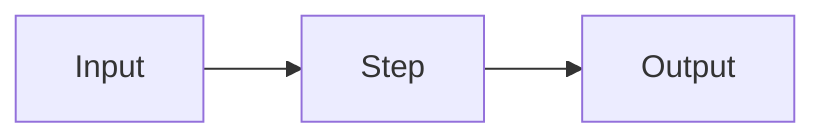

🏠 [Home](../../README.md) › [NN · Chapter title](./README.md) › N.M Page title

# N.M Page title

> **Difficulty:** 🟢 Beginner · **Reading time:** ~8 min · **Prerequisites:** [N.M Earlier page](./NN.M-earlier-page.md)

**In one sentence:** The whole idea of this page in one line.

📑 **On this page**

- [Why does this matter?](#-why-does-this-matter)
- [The idea, in plain words](#-the-idea-in-plain-words)
- [Picture it](#-picture-it)
- [How it works, step by step](#-how-it-works-step-by-step)
- [Worked example](#-worked-example)
- [Code](#-code)
- [Common mistakes & gotchas](#-common-mistakes--gotchas)
- [Key takeaways](#-key-takeaways)
- [Try it yourself](#-try-it-yourself)
- [Further reading](#-further-reading)

## 🤔 Why does this matter?

A real-world problem this concept solves. Start with a short story or scenario.

## 🧠 The idea, in plain words

A simple explanation with an everyday analogy. Link each glossary term on first use, for example [agent](../../GLOSSARY.md#agent).

## 👀 Picture it



*Caption: what the reader should notice in this diagram.*

## 🔍 How it works, step by step

1. First step, one level deeper than the plain explanation.
2. Second step.
3. Third step.

## 💡 Worked example

A concrete scenario traced end to end, showing the real messages, tool calls and outputs.

```text
Thought:     ...
Action:      ...
Observation: ...
```

## 💻 Code

Minimal, runnable, commented Python. Start with the raw provider API, then show a framework version if useful.

```python
# Full version: examples/NN-example-name/main.py
```

## 🚨 Common mistakes & gotchas

- **Mistake:** what goes wrong in practice. **Fix:** how to avoid it.

## ✅ Key takeaways

- Three to five short bullets.

## 🧪 Try it yourself

1. A small exercise.

<details>
<summary>Show answer</summary>

The answer.

</details>

## 📚 Further reading

- [Official documentation or original paper](https://example.com), one line on why it is worth reading.

<!-- FOOTER -->

---

⬅️ **Previous:** [N.M-1 Previous page](./README.md) ·
🏠 [Chapter home](./README.md) ·
➡️ **Next:** [N.M+1 Next page](./README.md)
